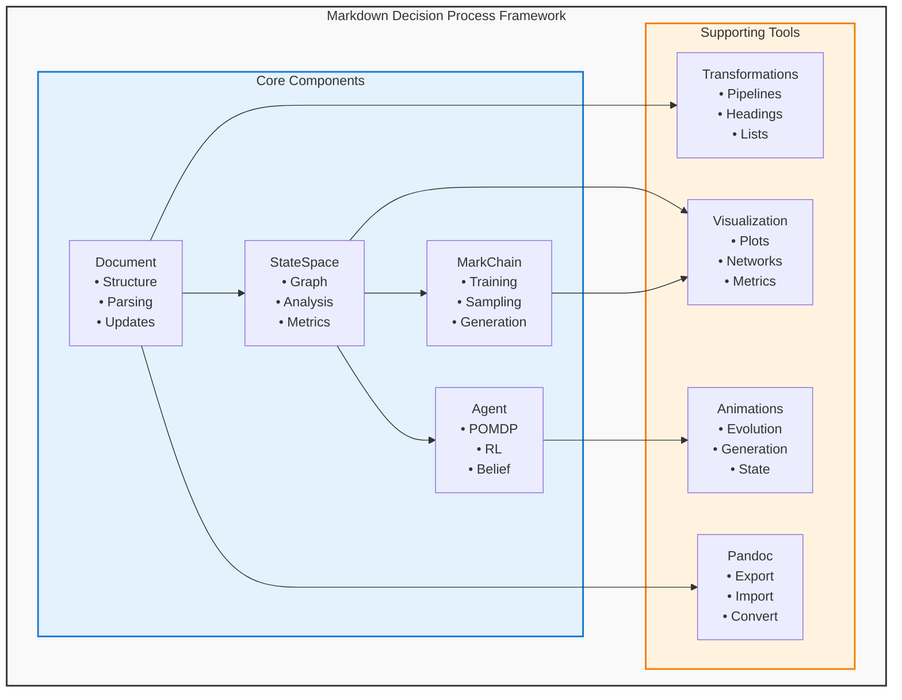

# Markdown Decision Process (MDP) 🎲📄

[](https://www.python.org/downloads/)
[](https://creativecommons.org/licenses/by-nc-sa/4.0/)
[](https://doi.org/10.5281/zenodo.17244387)

> **A comprehensive framework for probabilistic document analysis, generation, and optimization through the lens of Markov Decision Processes.**

## 🤖 Agent orientation (start here)

- **What this is:** a Python library treating Markdown documents as
  Markov Decision Processes (v0.3.0 — see `pyproject.toml`).
- **Current status:** no dated status surface is maintained; verify live
  with `python3 run_all_tests.py` (known-failing files are skipped and
  listed in that script). Open work lives in [TODO.md](TODO.md).
- **Next actions:** the single backlog is [TODO.md](TODO.md) (Minor /
  Medium / Major). Feature roadmap: [docs/ROADMAP.md](docs/ROADMAP.md).
- **Agent conventions:** [AGENTS.md](AGENTS.md) — architecture, code
  style, testing strategy, MDP terminology rules.

The Markdown Decision Process framework treats Markdown documents as **stochastic decision processes**, enabling:

- 🎯 **Policy-based optimization** using reinforcement learning
- 🔄 **Markov chain generation** from learned document patterns
- 🧠 **Probabilistic semantic inference** with belief updating (POMDP)
- 📊 **Graph-theoretic structural analysis** with comprehensive metrics
- 🎨 **Interactive visualizations** and evolution animations
- 🔌 **Extensible plugin architecture** for domain-specific customization

## ✨ Key Features

### 🏗️ Core Components

| Component | Description | Key Methods |
|-----------|-------------|-------------|
| **Document** | Core Markdown document representation | `get_structure()`, `update_content()` |
| **MarkChain** | Markov chain for text generation | `train()`, `sample()`, `generate()` |
| **StateSpace** | Graph-based document structure analysis | `analyze()`, `visualize()`, `get_successor_states()` |
| **PolicyOptimizer** | Reinforcement learning for document optimization | `optimize()`, `value_iteration()`, `q_learning()` |
| **BeliefUpdater** | Semantic belief state management | `update_from_observation()`, `get_all_beliefs()` |
| **MarkdownAgent** | Autonomous document processing agent | `interact()`, `analyze()`, `optimize()` |

### 🎛️ Advanced Features

- **Transformation Pipeline**: Sequential document transformations
- **Animation Engine**: Dynamic visualizations of document evolution
- **Pandoc Integration**: Multi-format document conversion
- **Plugin Architecture**: Extensible transformation and reward functions
- **Property-Based Testing**: Comprehensive edge case coverage

## 🚀 Quick Start

### Installation

```bash
# Via pip
pip install markdown-decision-process

# Or from source
git clone https://github.com/docxology/markdown_decision_process.git
cd markdown_decision_process
pip install -e .
```

### Basic Usage

```python
from mdp import Document, StateSpace, MarkChain, PolicyOptimizer

# 1. Parse and analyze a document
doc = Document(content="""
# Introduction
This framework treats documents as Markov Decision Processes.

## Features
- Probabilistic modeling
- Policy optimization
- Semantic inference
""")

# 2. Build state space representation
state_space = StateSpace(doc)
analysis = state_space.analyze_structure()
print(f"States: {len(state_space.states)}")
print(f"Transition density: {analysis['graph_density']:.3f}")

# 3. Train Markov chain for generation
chain = MarkChain(order=2, smoothing=0.01)
chain.train([doc.content])
generated = chain.generate(length=100)
print(f"Generated:\n{generated}")

# 4. Optimize document with RL
optimizer = PolicyOptimizer(state_space)
result = optimizer.optimize()
print(f"Quality improvement: {result.quality_improvement:.2%}")
```

### Advanced Example

```python
from mdp import BeliefUpdater, CompositeReward
from mdp.quality import ReadabilityReward, StructureReward

# Semantic analysis with belief updating
belief_updater = BeliefUpdater(
    semantic_classes=['instruction', 'explanation', 'example']
)

for state in state_space.states:
    belief_updater.update_beliefs_from_state(state)
    semantic_class = belief_updater.get_most_likely_class()
    confidence = belief_updater.get_confidence()
    print(f"{state.state_type}: {semantic_class} ({confidence:.1%})")

# Multi-objective optimization
reward = CompositeReward({
    'readability': ReadabilityReward(weight=0.4),
    'structure': StructureReward(weight=0.3),
    'coherence': SemanticCoherenceReward(weight=0.3)
})

optimizer = PolicyOptimizer(state_space, reward_function=reward)
result = optimizer.optimize()
```

## 📚 Documentation

### Core Concepts

#### States and Transitions
In MDP, Markdown elements become **states**:
- `# Heading` → `header` state
- `Paragraph text` → `paragraph` state  
- `- List item` → `list` state
- ````python`code` → `code` state

**Transitions** represent how elements flow together, creating a **Markov Decision Process** where each state has probabilistic connections to others.

#### Reward Functions
Define what makes a document "good":

```python
def readability_reward(element):
    """Reward readable paragraph lengths"""
    if element['type'] == 'paragraph':
        word_count = len(element['text'].split())
        if 50 <= word_count <= 150:
            return 1.0
        elif word_count > 200:
            return -0.5
    return 0.0
```

#### Belief States
Track semantic understanding of document intent:

```python
updater = BeliefUpdater()
updater.update_from_observation({
    "instruction": 0.7,
    "example": 0.2,
    "reference": 0.1
})
```

### Advanced Usage

#### Custom Transformations

```python
from mdp import TransformationPipeline, HeadingLevelTransformation

# Create transformation pipeline
pipeline = TransformationPipeline([
    HeadingLevelTransformation(increment=1),  # Increase all headings by 1 level
    ListFormatTransformation("ordered")      # Convert lists to ordered format
])

# Apply transformations
pipeline.apply(document, "output.md")
```

#### Policy Optimization

```python
from mdp import PolicyOptimizer

optimizer = PolicyOptimizer(state_space=state_space)
optimizer.set_reward_function(custom_reward_function)

# Optimize using reinforcement learning
result = optimizer.optimize(document)
print(f"Final reward: {result['final_reward']}")
```

#### Document Generation

```python
from mdp import MarkChain

# Train on corpus
chain = MarkChain()
chain.train(corpus_content)

# Generate new content
generated = chain.sample(start_state="header", length=500)
```

## 🎨 Visualizations & Animations

### Static Visualizations

```python
from mdp import plot_document_structure, plot_transitions

# Document structure visualization
fig = plot_document_structure(document)
fig.savefig("structure.png")

# State transition visualization  
fig = plot_transitions(markchain)
fig.savefig("transitions.png")
```

### Dynamic Animations

```python
from mdp import create_comprehensive_animation

# Create animated visualizations
outputs = create_comprehensive_animation(
    "document.md",
    "animations/",
    formats=["gif", "mp4"]
)
```

## 🔧 Installation

### Requirements
- Python 3.8+
- pip or uv package manager

### Basic Installation

```bash
# Install from PyPI
pip install markdown-decision-process

# Or install from source
git clone https://github.com/docxology/markdown_decision_process.git
cd markdown_decision_process
pip install -e .
```

### Optional Dependencies

```bash
# Install with all optional features
pip install markdown-decision-process[all]

# Or install specific features:
pip install markdown-decision-process[pandoc]  # Format conversion
pip install markdown-decision-process[ml]      # Advanced semantic analysis
pip install markdown-decision-process[dev]     # Development tools
pip install markdown-decision-process[docs]    # Documentation building
```

### Development Setup

```bash
# Clone repository
git clone https://github.com/docxology/markdown_decision_process.git
cd markdown_decision_process

# Create virtual environment
python -m venv venv
source venv/bin/activate  # On Windows: venv\Scripts\activate

# Install in development mode with all dependencies
# (dev extras include pytest, pytest-benchmark, hypothesis, textstat, wordcloud)
pip install -e ".[dev,docs,pandoc,ml]"

# Run tests to verify installation
pytest tests/ -v
```

## 🧪 Testing

```bash
# Run all tests
python -m pytest tests/

# Resilient runner (handles known-failing skips; see tests/README.md)
python3 run_all_tests.py

# Direct pytest on real test files
python -m pytest tests/test_integration.py # Integration tests
python -m pytest tests/test_performance.py # Performance benchmarks

# Run with coverage
python -m pytest --cov=src tests/
```

**Test status:** not tracked as a prose number — see [TODO.md](TODO.md) for the verification protocol; run `python3 run_all_tests.py` to check current state.

## 📖 API Reference

### Document Class
```python
class Document:
    def __init__(self, file_path=None, content=None)
    def get_structure(self) -> List[Dict]
    def update_content(self, content: str)
    def save(self, path: str)
```

### StateSpace Class
```python
class StateSpace:
    def __init__(self, document: Document)
    def analyze(self, filepath: Union[str, Path])
    def visualize(self, output_path: str)
    def get_successor_states(self, state_id: str) -> List[str]
```

### MarkChain Class
```python
class MarkChain:
    def __init__(self, order: int = 1)
    def train(self, markdown_text: str)
    def sample(self, start_state: str, length: int) -> str
    def generate(self, prompt: str, length: int) -> str
```

### PolicyOptimizer Class
```python
class PolicyOptimizer:
    def __init__(self, state_space=None, reward_function=None)
    def set_reward_function(self, reward_fn: Callable)
    def optimize(self, document, output_path=None) -> Dict
    def value_iteration(self, max_iterations: int) -> Dict
    def q_learning(self, episodes: int) -> Dict
```

### BeliefUpdater Class
```python
class BeliefUpdater:
    def __init__(self, semantic_classes: List[str] = None)
    def update_from_observation(self, observation: Dict[str, float])
    def get_all_beliefs(self) -> Dict[str, float]
```

### MarkdownAgent Class
```python
class MarkdownAgent:
    def __init__(self, exploration_rate: float = 0.2)
    def train(self, corpus_path: str)
    def analyze(self, markdown_input) -> Dict
    def interact(self, content: str, objective: str) -> Dict
```

## 🎯 Use Cases

### 📝 Document Optimization
Automatically improve document structure and readability:
```python
agent = MarkdownAgent()
result = agent.interact(content, objective="optimize")
optimized_content = result["modified_content"]
```

### 🎨 Content Generation
Generate contextually appropriate content:
```python
chain = MarkChain()
chain.train(corpus)
new_section = chain.sample("header", length=200)
```

### 📊 Document Analysis
Extract insights and metrics:
```python
analysis = agent.analyze(document)
print(f"Document coherence: {analysis['semantic_analysis']['coherence']}")
```

### 🔄 Format Conversion
Convert between document formats:
```python
from mdp import PandocConverter
converter = PandocConverter()
converter.convert("input.md", "output.pdf")
```

## 🏗️ Architecture



## 🎯 Use Cases

### Academic Writing
- Optimize paper structure and readability
- Generate consistent section patterns
- Analyze citation placement and flow
- Maintain semantic coherence across revisions

### Technical Documentation
- Standardize API documentation format
- Generate documentation from code patterns
- Optimize information architecture
- Ensure consistency across large doc sets

### Content Management
- Batch optimize documentation repositories
- Maintain style guidelines automatically
- Generate content summaries and overviews
- Track document quality metrics over time

### Educational Applications
- Create interactive writing tutorials
- Provide intelligent feedback on structure
- Generate practice examples
- Analyze student document patterns

## 🤝 Contributing

We welcome contributions! See [CONTRIBUTING.md](CONTRIBUTING.md) for guidelines.

### Quick Contribution Guide

1. **Fork** the repository
2. **Create** a feature branch: `git checkout -b feature/amazing-feature`
3. **Write** tests for new functionality (TDD approach)
4. **Implement** your feature following code standards
5. **Test** thoroughly: `pytest tests/ -v --cov`
6. **Document** in docstrings and update relevant docs
7. **Commit**: `git commit -m 'feat: Add amazing feature'`
8. **Push**: `git push origin feature/amazing-feature`
9. **Submit** a pull request

### Development Guidelines

- **Test-Driven Development**: Write tests before implementation
- **Type Hints**: Use comprehensive type annotations (Python 3.8+)
- **Documentation**: Google-style docstrings for all public APIs
- **Code Style**: Black formatter (88 char line length)
- **MDP Theme**: Maintain decision-theoretic terminology
- **No Mocks**: Use real data analysis in tests

### AI Agent Collaboration

See [AGENTS.md](AGENTS.md) for comprehensive guidance on:
- Repository architecture and patterns
- Module interdependencies
- Testing strategies
- Performance optimization
- Documentation standards

## 📄 License

This project is licensed under the **Creative Commons Attribution-NonCommercial-ShareAlike 4.0 International License** (CC BY-NC-SA 4.0) - see the [LICENSE](LICENSE) file for details.

### License Summary
- ✅ **Attribution**: Credit must be given to the creator
- ✅ **ShareAlike**: Adaptations must be shared under the same license
- ❌ **NonCommercial**: Commercial use is not permitted without explicit permission

For commercial licensing inquiries, contact: daniel@activeinference.institute

## 🙏 Acknowledgments

### Theoretical Foundations
- **Markov Decision Processes**: Sutton & Barto's foundational RL theory
- **Active Inference**: Karl Friston's free energy principle
- **POMDP Theory**: Kaelbling, Littman & Cassandra's framework

### Core Dependencies
- **NetworkX**: Graph analysis and algorithms
- **Matplotlib**: Visualization and plotting
- **Pandoc**: Universal document conversion
- **NumPy/SciPy**: Numerical computing

### Inspiration
- The Markdown community for creating a beautiful, simple format
- The reinforcement learning community for rigorous decision theory
- Document AI researchers pushing the boundaries of understanding

## 📞 Contact and Support

- **Repository**: [github.com/docxology/markdown_decision_process](https://github.com/docxology/markdown_decision_process)
- **Issues**: [Report bugs or request features](https://github.com/docxology/markdown_decision_process/issues)
- **Discussions**: [Community discussions](https://github.com/docxology/markdown_decision_process/discussions)
- **Documentation**: [Full API Reference](https://markdown-decision-process.readthedocs.io)
- **Paper**: [Academic paper](paper/outputs/MarkdownDecisionProcess_DAF_10-02-2025.pdf) | [DOI: 10.5281/zenodo.17244387](https://doi.org/10.5281/zenodo.17244387)
- **Email**: daniel@activeinference.institute

## 📚 Citation

If you use this framework in your research, please cite:

```bibtex
@software{mdp_framework,
  title={Markdown Decision Process: A Framework for Probabilistic Document Analysis and Optimization},
  author={Friedman, Daniel Ari},
  year={2025},
  url={https://github.com/docxology/markdown_decision_process},
  doi={10.5281/zenodo.17244387},
  version={0.1.0}
}
```

## 🗺️ Roadmap

See [ROADMAP.md](docs/ROADMAP.md) for detailed development plans. 

---

<div align="center">

**Treating documents as Markov Decision Processes since 1999** 🎲📄

*Where probability meets prose, and optimization meets organization.*

[⭐ Star us on GitHub](https://github.com/docxology/markdown_decision_process) • [📖 Read the Docs](https://markdown-decision-process.readthedocs.io) • [💬 Join Discussions](https://github.com/docxology/markdown_decision_process/discussions)

</div>