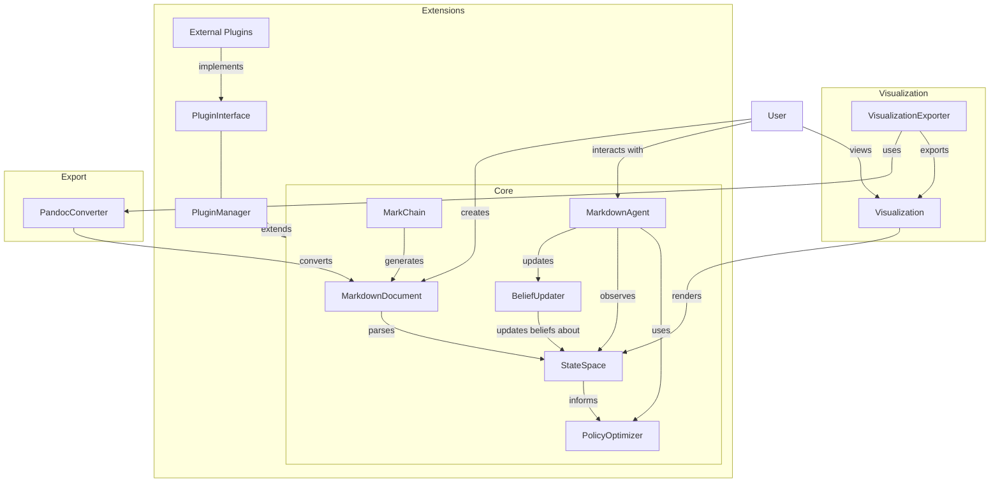
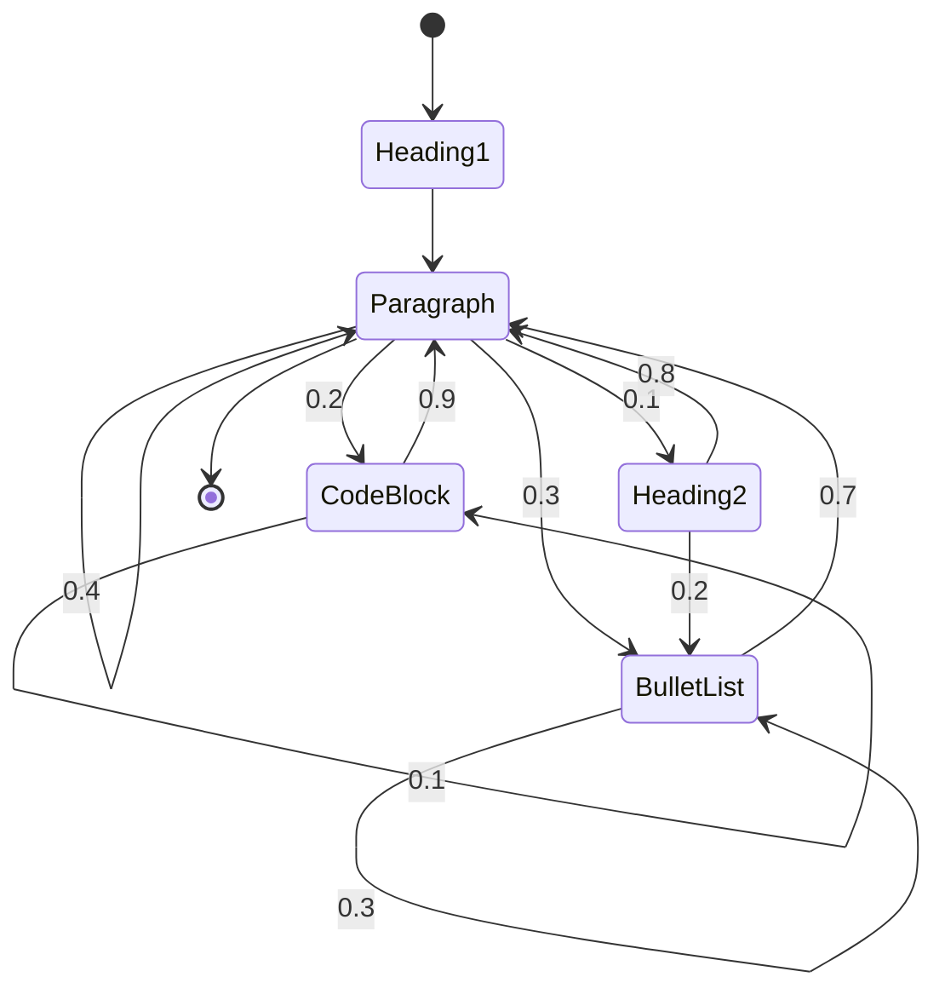
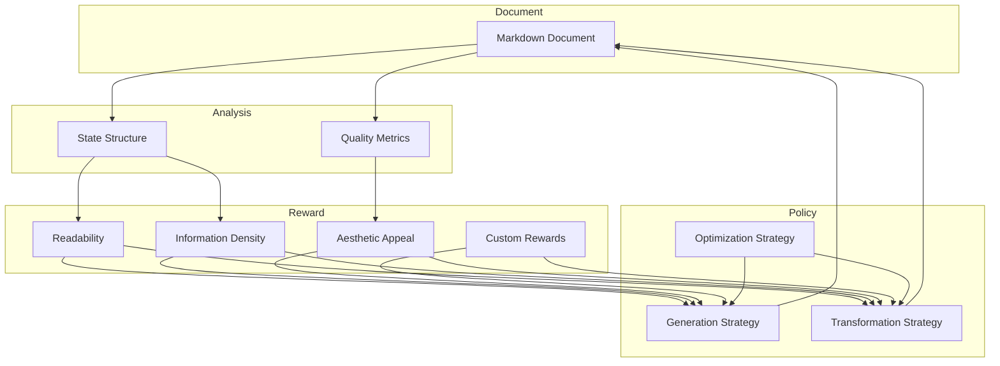
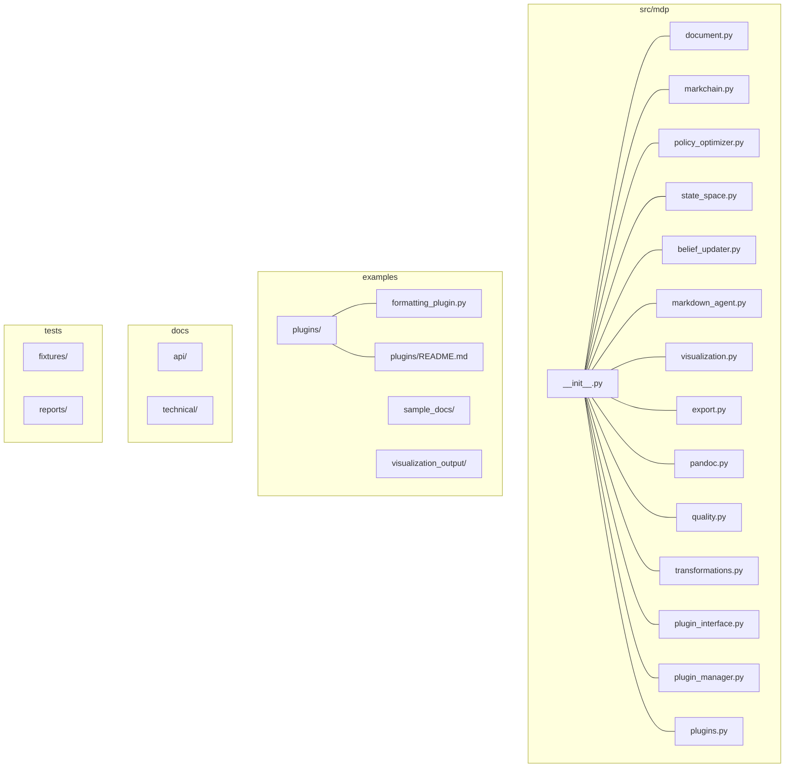
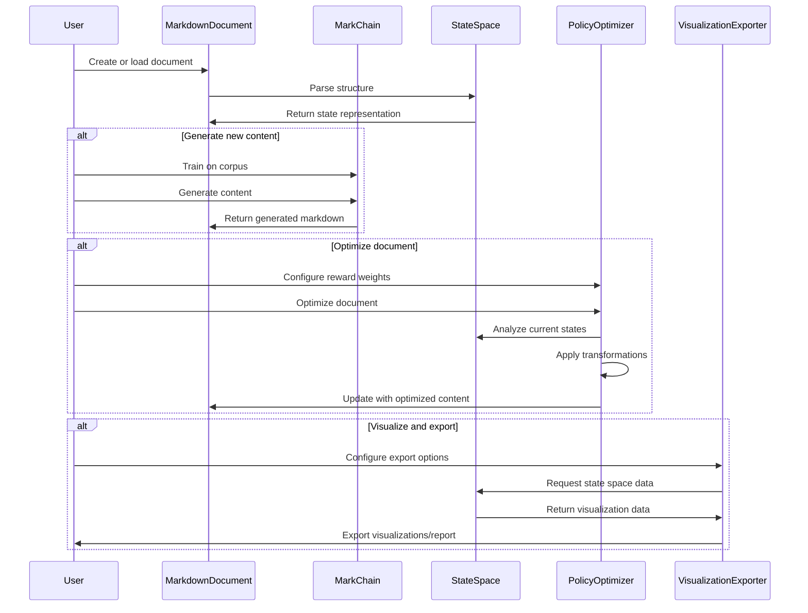

# Markdown Decision Process (MDP)

## Overview
Markdown Decision Process (MDP) is a framework that reimagines Markdown documents as stochastic processes analogous to Markov Decision Processes. This package provides tools to analyze, generate, and optimize Markdown content through the lens of decision theory and probabilistic modeling.

## Architecture



## Core Concepts

### States and Transitions
In MDP, Markdown elements (headings, paragraphs, lists, code blocks) represent *states* in a stochastic process. Transitions between these states follow probabilistic patterns that can be learned from existing documents or defined by optimization criteria.



### Partial Observability
Just as in POMDPs (Partially Observable Markov Decision Processes), the raw Markdown syntax only partially reveals the semantic meaning or rendered appearance of the content. MDP provides tools to reason about this uncertainty and make optimal decisions despite incomplete information.

### Rewards and Policies
MDP defines "reward functions" for Markdown structures based on readability, information density, and aesthetic appeal (reinforcement learning perspective). Additionally there is the option to use the probability likelihoods directly, framing the situation in terms of Active Inference and the Free Energy Principle. In either case, the package implements methods for inferring the optimal "policies" for generating and transforming Markdown files.



## Project Structure



## Features

- **MarkChain**: Generate Markdown using Markov chains trained on existing documents
- **StateSpace**: Visualize the state space and transition probabilities of your Markdown
- **PolicyOptimizer**: Transform Markdown documents to optimize for specified reward functions
- **BeliefUpdater**: Reason about semantic meaning from syntactic structure
- **MarkdownAgent**: An autonomous agent that explores and exploits the Markdown state space
- **VisualizationExporter**: Export visualizations and documents in various formats (PNG, PDF, SVG, HTML)
- **Plugin System**: Extend functionality with custom transformations and reward functions

## Installation

```bash
pip install markdown-decision-process
```

## Quick Start

```python
from mdp import MarkChain, PolicyOptimizer

# Generate Markdown using a trained model
generator = MarkChain.from_corpus("path/to/documents/")
new_document = generator.sample(length=500)

# Optimize an existing document
optimizer = PolicyOptimizer(reward_weights={"readability": 0.7, "information_density": 0.3})
improved_document = optimizer.transform("path/to/document.md")
```

### Visualization and Export

```python
from mdp import StateSpace, VisualizationExporter
from mdp.document import MarkdownDocument

# Analyze a document and visualize its state space
state_space = StateSpace()
state_space.parse_markdown_file("path/to/document.md")

# Initialize the exporter
exporter = VisualizationExporter(output_dir="outputs")

# Export state space visualization in different formats
exporter.export_state_space(state_space, "state_space.png")
exporter.export_state_space(state_space, "state_space.pdf")
exporter.export_state_space(state_space, "state_space.svg")

# Generate a comprehensive analysis report
document = MarkdownDocument(file_path="path/to/document.md")
exporter.export_analysis_report(document, "analysis_report.pdf")

# Export a document with embedded visualizations
exporter.export_document_with_visualizations(
    document="path/to/document_with_markers.md",
    output_path="enhanced_document.pdf",
    visualizations=[
        ("<!-- VISUALIZATION: STATE_SPACE -->", state_space_fig, {"format": "png"}),
    ],
    to_format="pdf"
)
```

### Using Plugins

```python
from mdp import MarkdownDocument, PluginManager
from mdp.plugins import MDPPlugin

# Register and use a custom plugin
plugin_manager = PluginManager()
plugin_manager.register_plugin("formatting", "examples.plugins.formatting_plugin")

# Use a plugin's transformations
document = MarkdownDocument(file_path="document.md")
formatted_content = plugin_manager.apply_transformation(
    "formatting.fix_headings", 
    document.get_content()
)

# Calculate reward using a plugin's reward function
consistency_score = plugin_manager.calculate_reward(
    "formatting.consistency_score", 
    formatted_content
)
```

## Document Processing Workflow



## Documentation

For comprehensive documentation, see [docs/](docs/README.md).

## License

This project is licensed under the MIT License - see the [LICENSE](LICENSE) file for details.

## Contributing

Contributions are welcome! Please see our [Contributing Guide](CONTRIBUTING.md) for more details. 