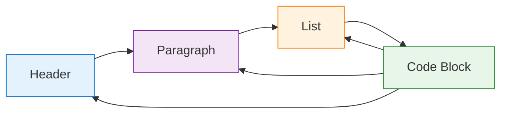

# Markdown Decision Process Documentation

## Introduction

Markdown Decision Process (MDP) is a humorous yet functional framework that reimagines Markdown documents as stochastic processes. It draws parallels between Markov Decision Processes and the creation, analysis, and transformation of Markdown content.

## Core Concepts

### State Space

In MDP, each Markdown element (headers, paragraphs, lists, code blocks) represents a *state* in a stochastic process. The transitions between these states follow probability distributions that can be learned from existing documents.



### Partial Observability

Just as in POMDPs (Partially Observable Markov Decision Processes), the raw Markdown syntax only partially reveals the semantic meaning of the content. MDP provides tools to reason about this uncertainty and make optimal decisions despite incomplete information.

For example, the following Markdown:

```markdown
## Warning

**Important**: Back up your data before proceeding.
```

Has a high probability of being a warning message, but could also be an instruction. MDP uses belief states to track this uncertainty.

### Rewards and Policies

MDP defines "reward functions" for Markdown structures based on metrics like readability, information density, and aesthetic appeal. It then implements "policies" for generating and transforming Markdown to maximize these rewards.

## Modules

### MarkChain

`MarkChain` learns the transition probabilities between Markdown elements and generates new content following these patterns.

```python
from mdp import MarkChain

# Train a model on existing markdown
chain = MarkChain()
chain.train(markdown_text)

# Generate new markdown
new_text = chain.sample(length=100)
```

### PolicyOptimizer

`PolicyOptimizer` transforms Markdown documents to optimize them according to specified reward functions.

```python
from mdp import PolicyOptimizer

optimizer = PolicyOptimizer(reward_weights={
    "readability": 0.7,
    "information_density": 0.3
})

improved_doc = optimizer.transform("document.md")
```

### StateSpace

`StateSpace` analyzes and visualizes the state space of Markdown documents, showing the transition probabilities between different elements.

```python
from mdp import StateSpace

visualizer = StateSpace()
visualizer.analyze("document.md")
visualizer.visualize("state_space.png")
```

### BeliefUpdater

`BeliefUpdater` models the uncertainty in interpreting the semantic meaning of Markdown elements, using Bayesian updates to maintain belief states.

```python
from mdp import BeliefUpdater

updater = BeliefUpdater()
analysis = updater.analyze_document("document.md")
updater.print_analysis(analysis)
```

## Advanced Usage

### Custom Reward Functions

You can define custom reward functions for the PolicyOptimizer:

```python
def image_density_reward(document_structure):
    """Reward documents with a good ratio of images to text."""
    image_count = sum(1 for e in document_structure 
                     if e['type'] == 'paragraph' and '![' in e['content'])
    text_blocks = sum(1 for e in document_structure if e['type'] == 'paragraph')
    
    if text_blocks == 0:
        return 0
    
    ratio = image_count / text_blocks
    # Optimal ratio is around 0.2-0.3 images per text block
    return 10 * (1 - abs(0.25 - ratio) * 2)

optimizer = PolicyOptimizer(
    custom_rewards={"image_density": image_density_reward},
    reward_weights={"readability": 0.5, "image_density": 0.5}
)
```

### Custom State Parsers

You can customize how MarkChain parses markdown into states:

```python
def semantic_state_parser(markdown_text):
    """Parse markdown based on semantic meaning rather than syntax."""
    # Custom parsing logic
    # ...
    for semantic_block in semantic_blocks:
        yield semantic_block

chain = MarkChain(state_parser=semantic_state_parser)
```

## API Reference

For detailed API reference, see:

- [MarkChain API](api/markchain.md)
- [PolicyOptimizer API](api/policy_optimizer.md)
- [StateSpace API](api/state_space.md)
- [BeliefUpdater API](api/belief_updater.rst)

Note (2026-08-31): per-module API pages exist only for the modules above.
The remaining modules (Document, transformations, visualization, animations,
pandoc, plugins) are documented in [API_COMPLETE.md](API_COMPLETE.md) and
their source docstrings under `src/mdp/`; the full Sphinx build
(`cd docs && python build_docs.py`) generates the rest on demand.

## Examples

See the [examples](../examples) directory for complete usage examples. 