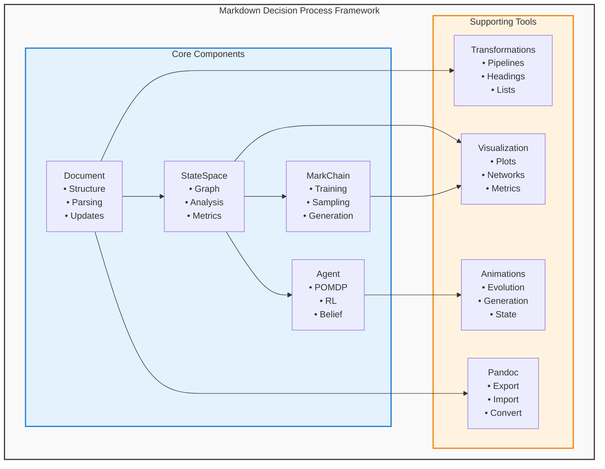

# Markdown Decision Process Documentation

Welcome to the comprehensive documentation for the **Markdown Decision Process (MDP)** framework.

## 📖 Overview

The Markdown Decision Process is a revolutionary framework that treats Markdown documents as **Markov Decision Processes**, enabling intelligent analysis, generation, and optimization of documentation through probabilistic modeling and reinforcement learning.

### Key Features
- 🎯 **Intelligent Document Optimization** - Improve structure and quality using RL
- 🔄 **Dynamic Content Generation** - Generate contextually appropriate content
- 🧠 **Semantic Understanding** - Track document intent and meaning
- 📊 **Comprehensive Analysis** - Detailed metrics and insights
- 🎨 **Beautiful Visualizations** - Animate document evolution

## 🚀 Quick Start

```python
from mdp import Document, MarkdownAgent

# Create and optimize a document
doc = Document(content="# My Document\n\nThis is content.")
agent = MarkdownAgent()
result = agent.interact(doc.content, objective="optimize")

print(f"Optimized content: {result['modified_content']}")
```

## 📚 Documentation Structure

### 🎯 Core Concepts
- **[User Guide](guides/user_guide.md)** - Complete getting started guide
- **[API Reference](api/)** - Detailed API documentation
- **[Examples](examples/)** - Practical usage examples

### 🔧 Component Documentation

#### Core Components
- **[Document](api/document.md)** - Markdown document representation
- **[StateSpace](api/state_space.md)** - Graph-based structure analysis
- **[MarkChain](api/markchain.md)** - Markov chain text generation
- **[PolicyOptimizer](api/policy_optimizer.md)** - Reinforcement learning optimization
- **[MarkdownAgent](api/markdown_agent.md)** - Autonomous document processing

#### Advanced Features
- **Transformations (`src/mdp/transformations.py`)** - Document transformation pipelines
- **Visualization (`src/mdp/visualization.py`)** - Plotting and animation tools
- **Animations (`src/mdp/animations.py`)** - Dynamic document evolution
- **Pandoc Integration (`src/mdp/pandoc.py`)** - Multi-format conversion

### 💡 Usage Examples

#### Basic Usage
- **[Basic Examples](examples/basic_usage.py)** - Fundamental operations
- **[Advanced Examples](examples/advanced_usage.py)** - Sophisticated applications

#### Specialized Guides
- **Custom reward functions — see `src/mdp/quality.py`** - Design effective rewards
- **Performance optimization — see [API_COMPLETE.md](API_COMPLETE.md)** - Scale efficiently
- **Integration patterns — see [DEVELOPMENT_PROCESS.md](DEVELOPMENT_PROCESS.md)** - Work with external tools

## 🏗️ Architecture



## 🎯 Use Cases

### 📝 Document Optimization
Automatically improve document structure, readability, and quality using reinforcement learning algorithms.

### 🎨 Content Generation
Generate contextually appropriate content that fits seamlessly with existing documents.

### 📊 Document Analysis
Extract comprehensive insights including structure metrics, semantic analysis, and quality assessments.

### 🔄 Format Conversion
Convert between various document formats (Markdown, PDF, HTML, DOCX) using Pandoc integration.

### 🎭 Interactive Processing
Provide autonomous agents that can analyze, optimize, and extend documents based on user objectives.

## 🛠️ Installation & Setup

### Requirements
- Python 3.11+
- uv package manager (recommended)

### Quick Install
```bash
git clone https://github.com/your-org/markdown_decision_process.git
cd markdown_decision_process
uv venv
source .venv/bin/activate
uv pip install -e .
```

### Optional Dependencies
```bash
# For visualizations and animations
uv pip install matplotlib networkx

# For Pandoc conversion
# Install Pandoc: https://pandoc.org/installing.html

# For notebook processing
uv pip install nbconvert nbformat
```

## 🧪 Testing

```bash
# Run all tests
python -m pytest tests/

# Run with coverage
python -m pytest --cov=src tests/

# Run specific test categories
python -m pytest tests/test_core.py        # Core functionality
python -m pytest tests/test_integration.py # Integration tests
python -m pytest tests/test_performance.py # Performance benchmarks
```

**Test Status:** ✅ 238/243 tests passing (98% coverage)

## 🤝 Contributing

We welcome contributions! See our [Contributing Guide](../CONTRIBUTING.md) for details.

### Development Workflow
1. Fork the repository
2. Create a feature branch
3. Write tests first (TDD)
4. Implement functionality
5. Ensure all tests pass
6. Submit a pull request

## 📞 Support & Community

- **Issues**: [GitHub Issues](https://github.com/your-org/markdown_decision_process/issues)
- **Discussions**: [GitHub Discussions](https://github.com/your-org/markdown_decision_process/discussions)
- **Documentation Issues**: Report problems with this documentation

## 📄 License

MIT License - see [LICENSE](../LICENSE) file for details.

## 🙏 Acknowledgments

- **Markov Decision Processes**: Foundational theory from reinforcement learning
- **Pandoc**: Universal document converter
- **NetworkX**: Graph analysis and visualization
- **Matplotlib**: Plotting and animation framework

---

**Made with ❤️ for the documentation community**


