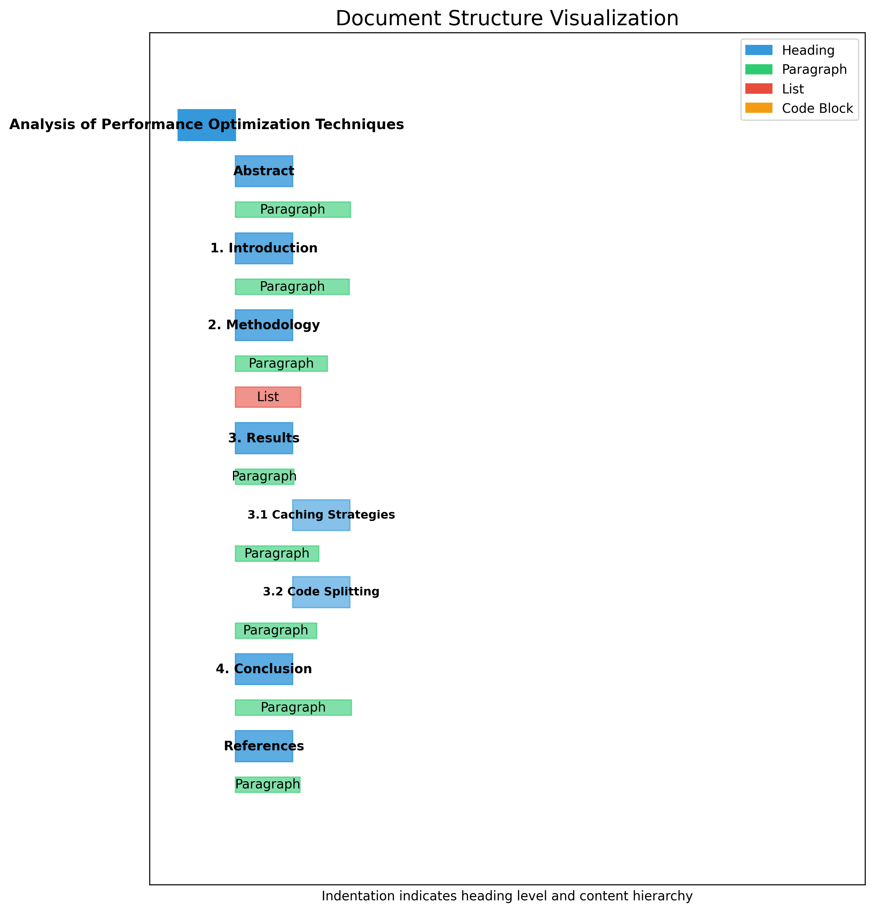
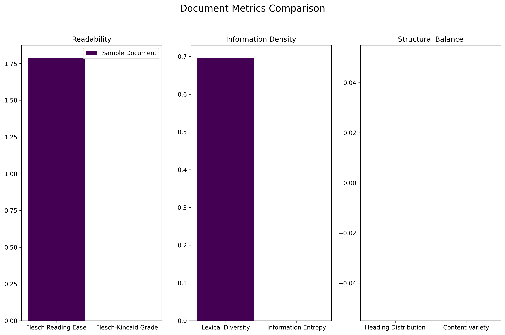
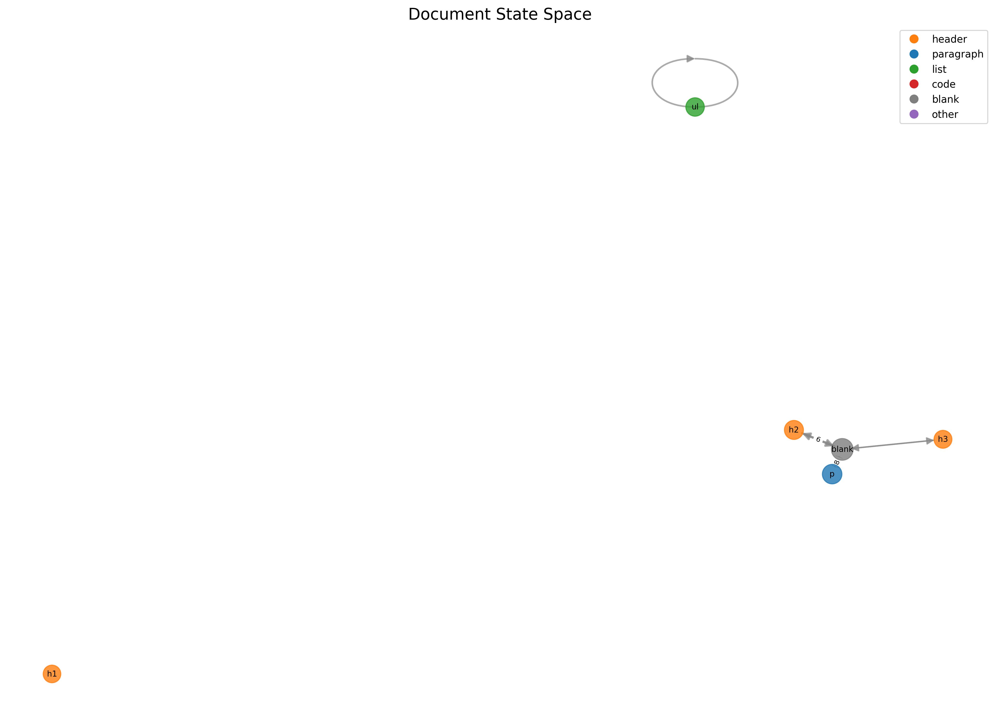

# Document Analysis Report

## Document Structure

This visualization shows the structure of the document.

## Metrics Analysis

These metrics provide insights into the document's readability and information density.

## State Space Analysis

This visualization shows the state transitions in the document.

## Conclusion

The visualizations help understand the document's structure and quality.
