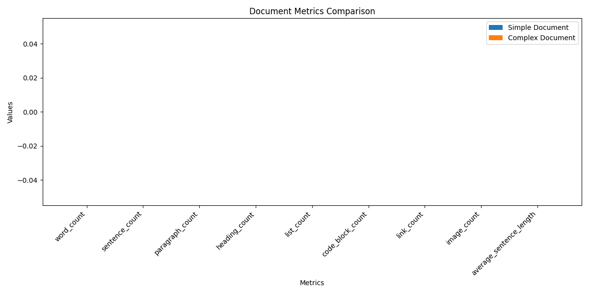

# Document Metrics Analysis

This file provides an analysis of metrics for two different markdown documents.

## Simple Document

```markdown
# Test Document

This is a paragraph with some **important** information.

## Section 1
- Item 1
- Item 2

### Subsection
Some more text here.

```python
def test_function():
    return "Hello World"
```

## Section 2
This is another paragraph.

```

### Metrics

| Metric | Value |
|--------|-------|
| avg_paragraph_length | 8.0 |
| code_block_ratio | 15.15151515151515 |
| complexity_score | 8.5 |
| heading_density | 12.121212121212121 |
| list_to_paragraph_ratio | 1.0 |
| structure_depth | 3 |

## Complex Document

```markdown
# Complex Document Analysis

## Introduction

This document contains a variety of markdown elements for testing document analysis metrics.

## Methods

The analysis is performed using several approaches:

1. First approach with detailed explanation
2. Second approach using alternative methodology
   - With sub-methodology A
   - With sub-methodology B
3. Third approach combining previous methods

### Data Collection

Data was collected from multiple sources:

* Primary sources (interviews)
* Secondary sources (literature)
* Tertiary sources (metadata analysis)

## Results

The results indicated several key findings:

| Metric | Value | Significance |
|--------|-------|--------------|
| Metric A | 85.2 | High |
| Metric B | 42.7 | Medium |
| Metric C | 93.1 | Very High |

### Statistical Analysis

```r
# Example R code
results <- analyze(data)
significance <- test_significance(results)
```

## Discussion

The findings suggest a strong correlation between variables X and Y, contrary to previous studies by Smith et al. (2018).

### Limitations

Several limitations must be acknowledged:

1. Sample size constraints
2. Geographical limitations
3. Temporal factors

## Conclusion

In conclusion, this analysis demonstrates the effectiveness of the proposed method and suggests directions for future research.

## References

1. Smith, J. (2018). Previous analysis methods. Journal of Analysis, 23(4), 45-67.
2. Johnson, A. (2020). Modern approaches to data collection. Research Methods Today, 15(2), 123-145.

```

### Metrics

| Metric | Value |
|--------|-------|
| avg_paragraph_length | 13.375 |
| code_block_ratio | 2.5906735751295336 |
| complexity_score | 7.5 |
| heading_density | 5.699481865284974 |
| list_to_paragraph_ratio | 0.5 |
| structure_depth | 3 |

## Comparison

### Metrics Comparison

| Metric | Simple | Complex | Difference | Ratio |
|--------|--------|---------|------------|-------|
| heading_density | 12.121212121212121 | 5.699481865284974 | -6.421730255927147 | 0.47x |
| complexity_score | 8.5 | 7.5 | -1.0 | 0.88x |
| code_block_ratio | 15.15151515151515 | 2.5906735751295336 | -12.560841576385616 | 0.17x |
| structure_depth | 3 | 3 | 0 | 1.00x |
| list_to_paragraph_ratio | 1.0 | 0.5 | -0.5 | 0.50x |
| avg_paragraph_length | 8.0 | 13.375 | 5.375 | 1.67x |

### Visualization



## Analysis & Interpretation

### Key Observations

- The complex document is 0.0x longer in terms of word count
- The complex document has 0 more headings, suggesting a more detailed structure
- The complex document contains 0 more Markdown elements (lists, code blocks, links, images, tables)
