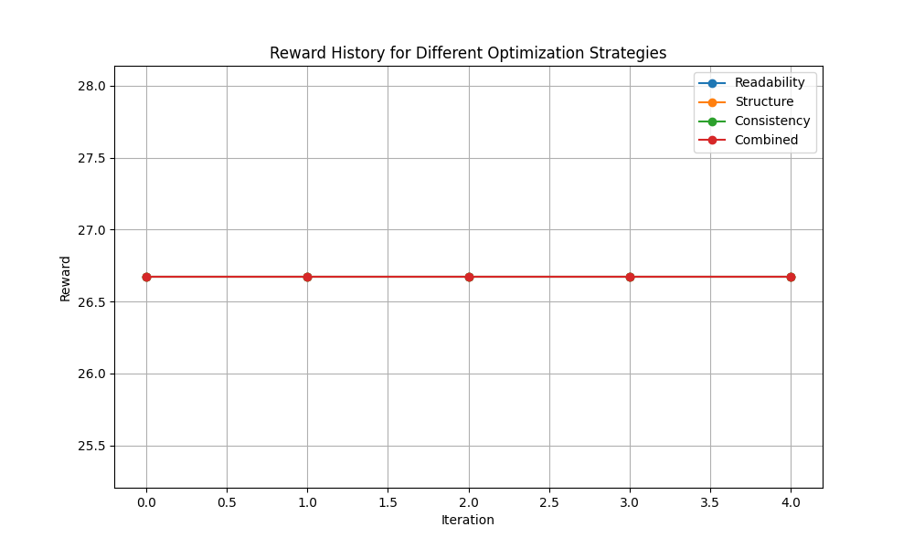
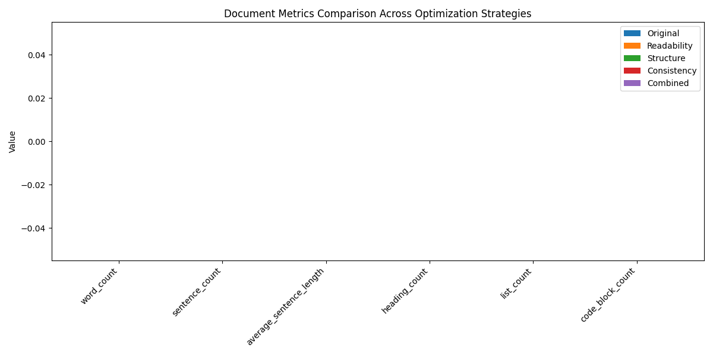

# Policy Optimization Comparison

This report compares the results of optimizing a document using different reward functions.

## Original Document

```markdown
# Test Document for Policy Optimization
    
This document will be optimized using different reward functions to see how they affect the outcome.

## Section 1: Readability Focus
Some text that could be improved in terms of readability.
A very long sentence with many complicated words and nested clauses that make it difficult to follow the main idea without getting lost in the details and confusing structure.

## Section 2: Structure Focus
- item 1
- item 2
* item 3
* item 4

### Subsection A
More content

### Subsection B
Even more content

## Section 3: Style Focus
This paragraph has *italicized* text and **bold** text with some _alternate_ styling.
    
```

### Original Metrics

| Metric | Value |
|--------|-------|
| avg_paragraph_length | 16.0 |
| code_block_ratio | 0.0 |
| complexity_score | 6.5 |
| heading_density | 5.9405940594059405 |
| list_to_paragraph_ratio | 1.0 |
| structure_depth | 3 |

## Optimization Results

### Readability Optimization

**Final Reward**: 26.67

**Iterations**: 5

#### Optimized Document

```markdown
# Test Document for Policy Optimization

This document will be optimized using different reward functions to see how they affect the outcome.

## Section 1: Readability Focus

Some text that could be improved in terms of readability.
A very long sentence with many complicated words and nested clauses that make it difficult to follow the main idea without getting lost in the details and confusing structure.

## Section 2: Structure Focus

- item 1
- item 2
* item 3
* item 4

### Subsection A

More content

### Subsection B

Even more content

## Section 3: Style Focus

This paragraph has *italicized* text and **bold** text with some _alternate_ styling.

```

#### Metrics

| Metric | Original | Optimized | Change |
|--------|----------|-----------|-------|
| avg_paragraph_length | 16.0 | 14.4 | -1.6 |
| code_block_ratio | 0.0 | 0.0 | +0 |
| complexity_score | 6.5 | 4.9 | -1.6 |
| heading_density | 5.9405940594059405 | 5.9405940594059405 | +0 |
| list_to_paragraph_ratio | 1.0 | 0.2 | -0.8 |
| structure_depth | 3 | 3 | +0 |

#### Reward History

| Iteration | Reward |
|-----------|-------|
| 0 | 26.67 |
| 1 | 26.67 |
| 2 | 26.67 |
| 3 | 26.67 |
| 4 | 26.67 |

### Structure Optimization

**Final Reward**: 26.67

**Iterations**: 5

#### Optimized Document

```markdown
# Test Document for Policy Optimization

This document will be optimized using different reward functions to see how they affect the outcome.

## Section 1: Readability Focus

Some text that could be improved in terms of readability.
A very long sentence with many complicated words and nested clauses that make it difficult to follow the main idea without getting lost in the details and confusing structure.

## Section 2: Structure Focus

- item 1
- item 2
* item 3
* item 4

### Subsection A

More content

### Subsection B

Even more content

## Section 3: Style Focus

This paragraph has *italicized* text and **bold** text with some _alternate_ styling.

```

#### Metrics

| Metric | Original | Optimized | Change |
|--------|----------|-----------|-------|
| avg_paragraph_length | 16.0 | 14.4 | -1.6 |
| code_block_ratio | 0.0 | 0.0 | +0 |
| complexity_score | 6.5 | 4.9 | -1.6 |
| heading_density | 5.9405940594059405 | 5.9405940594059405 | +0 |
| list_to_paragraph_ratio | 1.0 | 0.2 | -0.8 |
| structure_depth | 3 | 3 | +0 |

#### Reward History

| Iteration | Reward |
|-----------|-------|
| 0 | 26.67 |
| 1 | 26.67 |
| 2 | 26.67 |
| 3 | 26.67 |
| 4 | 26.67 |

### Consistency Optimization

**Final Reward**: 26.67

**Iterations**: 5

#### Optimized Document

```markdown
# Test Document for Policy Optimization

This document will be optimized using different reward functions to see how they affect the outcome.

## Section 1: Readability Focus

Some text that could be improved in terms of readability.
A very long sentence with many complicated words and nested clauses that make it difficult to follow the main idea without getting lost in the details and confusing structure.

## Section 2: Structure Focus

- item 1
- item 2
* item 3
* item 4

### Subsection A

More content

### Subsection B

Even more content

## Section 3: Style Focus

This paragraph has *italicized* text and **bold** text with some _alternate_ styling.

```

#### Metrics

| Metric | Original | Optimized | Change |
|--------|----------|-----------|-------|
| avg_paragraph_length | 16.0 | 14.4 | -1.6 |
| code_block_ratio | 0.0 | 0.0 | +0 |
| complexity_score | 6.5 | 4.9 | -1.6 |
| heading_density | 5.9405940594059405 | 5.9405940594059405 | +0 |
| list_to_paragraph_ratio | 1.0 | 0.2 | -0.8 |
| structure_depth | 3 | 3 | +0 |

#### Reward History

| Iteration | Reward |
|-----------|-------|
| 0 | 26.67 |
| 1 | 26.67 |
| 2 | 26.67 |
| 3 | 26.67 |
| 4 | 26.67 |

### Combined Optimization

**Final Reward**: 26.67

**Iterations**: 5

#### Optimized Document

```markdown
# Test Document for Policy Optimization

This document will be optimized using different reward functions to see how they affect the outcome.

## Section 1: Readability Focus

Some text that could be improved in terms of readability.
A very long sentence with many complicated words and nested clauses that make it difficult to follow the main idea without getting lost in the details and confusing structure.

## Section 2: Structure Focus

- item 1
- item 2
* item 3
* item 4

### Subsection A

More content

### Subsection B

Even more content

## Section 3: Style Focus

This paragraph has *italicized* text and **bold** text with some _alternate_ styling.

```

#### Metrics

| Metric | Original | Optimized | Change |
|--------|----------|-----------|-------|
| avg_paragraph_length | 16.0 | 14.4 | -1.6 |
| code_block_ratio | 0.0 | 0.0 | +0 |
| complexity_score | 6.5 | 4.9 | -1.6 |
| heading_density | 5.9405940594059405 | 5.9405940594059405 | +0 |
| list_to_paragraph_ratio | 1.0 | 0.2 | -0.8 |
| structure_depth | 3 | 3 | +0 |

#### Reward History

| Iteration | Reward |
|-----------|-------|
| 0 | 26.67 |
| 1 | 26.67 |
| 2 | 26.67 |
| 3 | 26.67 |
| 4 | 26.67 |

## Visualizations

### Reward History



### Metrics Comparison



## Analysis

- The **Readability** optimization achieved the highest reward (26.67).
- The **Readability** optimization required the most iterations (5).

### Structural Changes

- **Readability**: Heading count +0, List count +0
- **Structure**: Heading count +0, List count +0
- **Consistency**: Heading count +0, List count +0
- **Combined**: Heading count +0, List count +0
